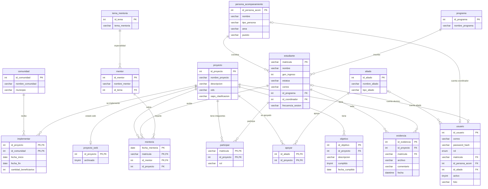
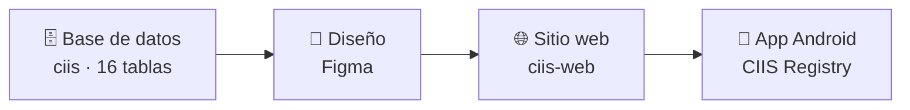
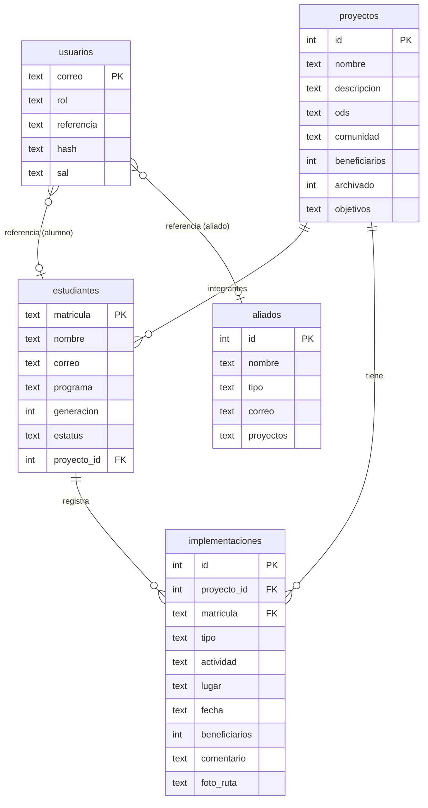

<div align="center">

# 🔴 🟡 ⬛ CIIS Registry · App móvil (Android)


---

### 📌 *App de seguimiento de proyectos de impacto social, estudiantes, aliados y mentorías del Centro de Innovación e Impacto Social (CIIS) UPAEP.*

**Versión móvil del sitio web `ciis-web`:** mismo modelo de datos, mismos roles (coordinación, alumno y aliado) y mismos reportes.

<br>

## 🔗 [**Ver el prototipo en Figma**](https://www.figma.com/design/5V8itGOa79Z8bqV3g0I6kD/App_layout?node-id=0-1)

`https://www.figma.com/design/5V8itGOa79Z8bqV3g0I6kD/App_layout?node-id=0-1`

*Ábrelo y presiona **▶ Presentar** para navegarlo como prototipo.*

</div>

---

## 📑 Contenido

1. [Planteamiento del problema](#-1-planteamiento-del-problema)
2. [Para qué sirve la app](#-2-para-qué-sirve-la-app-y-por-qué-ayuda)
3. [Paleta de colores](#-3-paleta-de-colores)
4. [Requerimientos](#-4-requerimientos)
5. [Modelo Entidad-Relación](#-5-modelo-entidad-relación-e-r)
6. [Proceso de desarrollo](#-6-proceso-de-desarrollo)
7. [Herramientas](#-7-herramientas)
8. [Cómo abrirlo en Android Studio](#-8-cómo-abrirlo-en-android-studio)
9. [Cuentas para probar la app](#-9-cuentas-para-probar-la-app)
10. [Limitación: recuperar la cuenta](#️-10-limitación-recuperar-la-cuenta-por-correo)
11. [Pantallas del Figma](#-11-pantallas-del-figma)
12. [Funciones acopladas del sitio web](#-12-funciones-acopladas-del-sitio-web)
13. [Permisos de Android](#-13-permisos-de-android)
14. [Registrar implementación](#-14-registrar-implementación-alumno)
15. [Base de datos SQLite](#️-15-base-de-datos-sqlite-en-el-teléfono)
16. [Estructura del código](#-16-estructura-del-código)
17. [Pendiente o diferente al Figma](#-17-pendiente-o-diferente-al-figma)

---

## 🧩 1. Planteamiento del problema

El CIIS UPAEP incuba y acompaña proyectos de impacto social en los que participan estudiantes de programas institucionales de liderazgo y becas (BL-UAF, UAF, Beca Liderazgo, voluntariado…). Concentra información de **estudiantes, coordinadores, mentores, beneficiarios y aliados**.

Antes, esa información estaba dispersa. Era difícil saber cuánto había avanzado cada proyecto, quién lo apoyaba, qué mentorías se habían dado y qué evidencias había del trabajo en las comunidades.

## 🎯 2. Para qué sirve la app (y por qué ayuda)

| Rol | Qué hace en la app |
| :--- | :--- |
| 🧑‍💼 **Coordinación** | Registra estudiantes, aliados, mentores y proyectos; asigna mentorías; ve el avance de todos los proyectos y descarga reportes para el seguimiento institucional. |
| 🎓 **Alumno** | Ve su proyecto y su avance por objetivos, agenda asesorías y sube **evidencias con fotos** de lo que hace en la comunidad (*registrar implementación*). |
| 🤝 **Aliado** | Empresas, fundaciones o gobierno: ve el avance de los proyectos que apoya y puede apoyar proyectos nuevos. |
| 🌐 **Público** | Catálogo de proyectos y sus evidencias, sin iniciar sesión. |

> 💡 Con la app, la información se captura **en el momento y desde el teléfono**: el alumno toma la foto en la comunidad y queda registrada al instante, y la coordinación tiene los datos listos para sus reportes.

## 🎨 3. Paleta de colores

El diseño sigue el Figma y la identidad visual del CIIS UPAEP:

| Color | Hexadecimal | Aplicación / Indicador |
| :--- | :--- | :--- |
| 🔴 **Rojo** | `#D32F2F` | Acento principal, botones y alertas |
| 🟡 **Amarillo / Ámbar** | `#FFC83D` / `#F2A30F` | Íconos de la bienvenida y estado *En progreso* |
| ⬛ **Pizarra** | `#4A5163` | Botón *Iniciar sesión* y esquina del splash |
| 🟢 **Verde** | `#2E9B57` | Estado *Terminado* y mensajes de éxito |
| 🩶 **Gris** | `#7A7F8C` | Texto secundario y estados inactivos |
| ⬜ **Fondo** | `#F5F5F5` | Fondo de las pantallas |

---

## 📋 4. Requerimientos

### Funcionales (por tipo de operación, igual que en el sitio web)

| Operación | Qué se puede hacer en la app |
| :--- | :--- |
| ➕ **Alta** | Registro de estudiante, aliado, mentor y proyecto; asignar mentoría; agendar asesoría; subir evidencia; **registrar implementación con foto** |
| 🔍 **Consulta** | Proyectos con filtro por estatus, detalle del proyecto (integrantes, aliados, mentorías, implementaciones y fotos), mentorías, reportes con gráficas y **reportes descargables** |
| ✏️ **Modificación** | Avance por objetivos (marcar o agregar objetivos), foto de perfil, activar cuenta, apoyar un proyecto |
| 🗑️ **Baja** | Archivar proyecto y cancelar asesoría |

Además:
* **3 roles** (coordinación, alumno y aliado) y una vista pública con el catálogo de proyectos.
* **Inicio de sesión** con correo y contraseña; la contraseña se guarda como hash, nunca tal cual.
* **Fotos** con la cámara o la galería, pidiendo permiso al sistema Android.
* **Exportar** reportes como archivo CSV (se abre en Excel) y compartirlos.
* Los **programas** son los mismos de la base `ciis`: BL-UAF, UAF, BL, Beca Liderazgo, Voluntaria, Voluntario, Voluntarios y Sin programa.

<details>
<summary><b>🔍 Haz clic para ver los Requerimientos No Funcionales</b></summary>

<br>

| Categoría | Especificación |
| :--- | :--- |
| **Protección y acceso** | Autenticación por roles (Coordinación, Alumno, Aliado). Contraseñas con hash PBKDF2 y sal. |
| **Conectividad** | Funciona **sin internet**: los datos se guardan en el teléfono con **SQLite**. |
| **Usabilidad e UI** | Interfaz en español, clara y con el diseño del Figma. |
| **Compatibilidad móvil** | Android 8.0 (API 26) o más nuevo, adaptable a distintos tamaños de pantalla. |
| **Privacidad** | Se piden permisos de cámara y galería solo cuando el usuario los necesita. |

</details>

---

## 🗂️ 5. Modelo Entidad-Relación (E-R)

La base `ciis` se diseñó y validó en la materia de **Base de Datos Avanzadas**. Tiene **16 tablas**: 12 del modelo base (`01_ciis.sql`) y 4 que agrega el sitio web (`02_web.sql`: `usuario`, `objetivo`, `evidencia` y `proyecto_web`).



<details>
<summary><b>📖 Haz clic para ver qué guarda cada tabla</b></summary>

<br>

| Tabla | Qué guarda |
| :--- | :--- |
| `estudiante` | Alumnos: matrícula, generación, estatus, programa y su coordinador |
| `persona_acompanamiento` | Coordinadores y personal que acompaña a los alumnos |
| `programa` | Programas institucionales (BL-UAF, UAF, Beca Liderazgo…) |
| `participar` | Qué estudiante está en qué proyecto y con qué rol |
| `proyecto` | Proyectos de impacto social, su ODS y clasificación SAPS |
| `proyecto_web` | Si el proyecto está archivado en el sitio |
| `implementar` | En qué comunidad se implementa cada proyecto, fechas y beneficiarios |
| `comunidad` | Comunidades y municipio |
| `objetivo` | Objetivos de cada proyecto y si ya se cumplieron (avance) |
| `mentoria` | Mentorías: fecha, estudiante, mentor y proyecto |
| `mentor` | Mentores y su tema |
| `tema_mentoria` | Temas de mentoría |
| `aliado` | Empresas, fundaciones o gobierno que apoyan proyectos |
| `apoyar` | Qué aliado apoya qué proyecto |
| `evidencia` | Fotos y comentarios que suben los alumnos |
| `usuario` | Cuentas de inicio de sesión por rol |

</details>

---

## 🛠️ 6. Proceso de desarrollo



1. **Base de datos**: se diseñó y validó la base `ciis` (16 tablas, vistas y procedimientos) en la materia de Base de Datos Avanzadas.
2. **Diseño**: se hicieron las pantallas en **Figma** (prototipo de arriba), primero para el móvil y después para la web.
3. **Sitio web**: se publicó **ciis-web** en un servidor Linux (Ubuntu + Nginx + PHP-FPM + MySQL) en la materia de Sistemas Operativos.
4. **App Android** (este proyecto): se programaron las pantallas del Figma y se acoplaron las funciones del sitio web: carga de fotos, reportes descargables, los mismos programas y los mismos roles. Se usaron los temas vistos en clase: Activities, layouts XML con ConstraintLayout, listeners, intents explícitos e implícitos, permisos y SQLite.

## 🧰 7. Herramientas

| Herramienta | Para qué |
| :--- | :--- |
|  + Gradle | Programar y compilar la app |
|   | Java en las pantallas clásicas (`MainActivity`, `RegistrarImplementacionActivity`, `BaseDatos`); Kotlin con Jetpack Compose en el resto |
| XML + ConstraintLayout | Layouts del splash y del registro de implementación |
|  | Base de datos dentro del teléfono (`SQLiteOpenHelper`) |
| Intents | Explícitos para cambiar de pantalla; implícitos para cámara, galería, calendario y compartir archivos |
|  | Diseño y prototipo |

---

## 🚀 8. Cómo abrirlo en Android Studio

1. Descomprime la carpeta `CIISRegistry`.
2. En Android Studio: **File → Open…** y elige la carpeta `CIISRegistry` (la que tiene `settings.gradle.kts`).
3. Espera a que termine **Gradle Sync**. La primera vez descarga dependencias y tarda unos minutos. Necesitas internet.
   * Si Android Studio ofrece actualizar el *Android Gradle Plugin*, acepta.
   * Si pide un SDK, instala **Android 15 (API 35)** desde *SDK Manager*.
4. Crea o elige un emulador en **Device Manager** (por ejemplo, Pixel 8 con API 34 o 35), o conecta tu teléfono con la depuración USB activada.
5. Presiona **Run ▶**.

> 📌 Requisitos: Android Studio Ladybug (2024.2) o más nuevo, JDK 17 (ya viene con Android Studio). El teléfono debe tener Android 8.0 o más nuevo.

## 🔑 9. Cuentas para probar la app

Cualquiera puede entrar con estas cuentas para probar la app:

| Rol | Usuario | Contraseña |
| :--- | :--- | :--- |
| 🧑‍💼 Coordinación | `coordi01@gmail.com` | `Elote01234` |
| 🧑‍💼 Coordinación | `coordi02@gmail.com` | `Jama&c4s` |
| 🎓 Alumno (Ana López · A0375 · Huertos comunitarios) | `alumno01@gmail.com` | `PatataV1ej4` |
| 🎓 Alumno (Isabel Rojas · A0521 · Robótica para niñas) | `alumno02@gmail.com` | `Arr0zFr1to` |
| 🤝 Aliado (Fundación Bepensa) | `aliado01@gmail.com` | `Municio0s123` |

Estas cuentas se crean en la tabla `usuarios` de SQLite la primera vez que se abre la app (`BaseDatos.onCreate()`). Si ya tenías instalada una versión anterior, se agregan solas al actualizar (`onUpgrade()`), sin borrar lo que ya habías registrado.

**Alumnos y aliados nuevos**: la coordinación los registra (pestaña **Registro**). Después, la persona entra a **Iniciar sesión → «¿Primera vez? Activa tu cuenta»**, escribe su correo y crea su contraseña. Un alumno con estatus *En pausa* no puede activar su cuenta ni entrar.

## ⚠️ 10. Limitación: recuperar la cuenta por correo

> [!NOTE]
> La opción **«¿No logras ingresar?»** muestra el formulario, pero **por ahora no envía el correo** para recuperar la cuenta; solo avisa que la función está en desarrollo.

Esto es porque son **dos tareas diferentes**, independientes de la base de datos:

1. ✅ **Dar de alta** al alumno y capturar su información, creando su registro en la base de datos. *Esto sí está hecho.*
2. ⏳ **Mandarle el correo** para completar el registro o recuperar su contraseña. *Es una tarea aparte.*

Para el envío del correo hay dos caminos: cederle la responsabilidad a otra app con un **Intent** (por ejemplo, abrir la app de correo del teléfono con un `IntentFilter`), o **programar nosotros el envío automático**, lo que requiere un servidor de correo y más pasos. Para cumplir los requisitos del proyecto basta con **crear los usuarios en la base de datos**, y no nos da tiempo de hacer todos los pasos del envío automático, así que por ahora no se incluye como funcional. Mientras tanto, la coordinación ayuda a restablecer las cuentas.

---

## 📱 11. Pantallas del Figma

<details>
<summary><b>🖼️ Haz clic para ver qué pantalla del Figma corresponde a cada parte de la app</b></summary>

<br>

| Figma | En la app |
| :--- | :--- |
| Splash | `MainActivity` (Java + XML), pasa sola a la bienvenida |
| Bienvenida | Primera pantalla de `AppActivity` |
| Proyectos y evidencias (público) | Bienvenida → **Visualiza un proyecto** (carrusel deslizable) |
| InicioSesion, ErrorInicioSesion | Iniciar sesión. Los errores (campos vacíos, datos incorrectos, cuenta sin activar) salen en una ventana |
| (nueva, como en ciis-web) | **¿Primera vez? Activa tu cuenta** |
| SesiónNoLograda, RecuperarCuenta | **¿No logras ingresar?** |
| SesiónAlumno, AlumnoProgreso, AlumnoMentorias | Pestañas General · Progreso · Mentorías |
| FotoPerfil | Toca tu foto en *Mi perfil*: usa la **cámara** o la **galería** |
| Mi proyecto, Subir evidencia, Evidencia enviada | *Mi proyecto* y **Subir evidencia** (cámara o galería y comentario) |
| AgendarAsesoria, AsesoriaAgendada, CancelarAsesoria, AsesoriaCancelada | Pestaña Mentorías |
| SesiónAliado, AliadoProyectos, AliadoApoyos, ApoyoConfirmado, DetalleProyectoAliado | Pestañas General · Proyectos · Apoyos |
| SesiónCoord, CoordProyectos, DetalleProyecto, CoordRegistro | Pestañas Proyectos · General · Registro |
| AltaEstudiante, AltaAliado, AltaMentor, AltaProyecto, AsignarMentoria, RegistroExitoso | Pestaña Registro |
| CoordReportes, ReporteDescargado, ErrorSinDatos | General → **Ver reportes** |
| Todas las pantallas Error… | Ventanas de aviso con botón **Regresar**. Salen solo cuando la validación real falla, como en ciis-web |

</details>

### ✅ Reglas que ya funcionan

* **Avance por objetivos** (nota del Figma): No iniciado 0 %, En progreso según los objetivos cumplidos, Archivado 0 %, Terminado 100 %. En la pestaña *Progreso*, el alumno marca objetivos o agrega nuevos, y el avance se recalcula.
* **Validaciones del registro**: matrícula con formato A + números y sin repetir, correo válido, aliado y mentor sin repetir, tema repetido, fechas del proyecto, al menos un integrante, y aviso si un estudiante ya tiene proyecto.
* **Reporte sin datos**: si en el periodo elegido no hay mentorías ni evidencias, sale el aviso *Sin datos para el periodo*.
* **Mentorías**: no se aceptan fechas pasadas y un mentor no puede tener dos mentorías a la misma hora.
* **Aliados**: máximo 10 proyectos por aliado; no puede apoyar dos veces el mismo proyecto.
* **Calendar** (nota del Figma): al asignar o agendar una mentoría, el botón **Agregar a Calendar** abre el calendario del teléfono con el evento listo y el correo del mentor como invitado.
* **Reporte**: *Descargar reporte* guarda un archivo `.csv` en **Descargas**, que se abre en Excel.

## 🔗 12. Funciones acopladas del sitio web

| Sitio web (ciis-web) | En la app |
| :--- | :--- |
| Subir evidencia con foto (tomar o elegir) | **Subir evidencia** y **Registrar implementación**, con cámara o galería |
| Foto de perfil | Tocar tu foto en *Mi perfil* |
| Foto del proyecto (la evidencia más reciente) | Aparece en las tarjetas de proyectos y arriba del detalle del proyecto |
| Reportes descargables (CSV / Excel) | **Reportes → Más reportes**: Avance por objetivos, Proyectos operativos, Resumen de estudiantes, Mentorías por mentor e Implementaciones. Más el reporte de progreso con gráficas |
| Descargar archivo | El CSV se guarda en **Descargas** y se puede **compartir** (correo, WhatsApp, Drive…) con un intent implícito `ACTION_SEND` |
| Programas de la tabla `programa` | La lista de **Programa** en *Alta de estudiante* |

## 🔐 13. Permisos de Android

Al tocar el **símbolo de la imagen** en *Registrar implementación* (o los botones Cámara / Galería), la app pide permiso al sistema con `ActivityCompat.requestPermissions()`:

| Permiso | Para qué |
| :--- | :--- |
| 📷 `CAMERA` | Tomar la foto del proyecto con la cámara |
| 🖼️ `READ_MEDIA_IMAGES` (Android 13+) / `READ_EXTERNAL_STORAGE` (Android 8–12) | Elegir una foto de la galería |

La respuesta llega en `onRequestPermissionsResult()`. Si el usuario acepta, se abre la cámara o la galería; si no, la app explica que puede activarlo en *Ajustes → Apps → CIIS Registry → Permisos*. En Android 14, dar acceso solo a "algunas fotos" también cuenta como permitido. La foto de perfil y las evidencias (pantallas de Compose) también piden el permiso de cámara antes de abrirla.

## 📸 14. Registrar implementación (alumno)

En **Mi perfil** (pestaña General del alumno) y en la pestaña *Progreso* está el botón **Registrar implementación**. Abre `RegistrarImplementacionActivity` con un intent explícito. Ahí el alumno:

1. Elige el tipo de actividad (Spinner con `OnItemSelectedListener`).
2. Escribe qué hicieron, el lugar y cuántas personas se beneficiaron.
3. Elige la fecha en un calendario (`DatePickerDialog` con `OnDateSetListener`).
4. Agrega una foto con **intents implícitos**:
   * **Cámara**: `MediaStore.ACTION_IMAGE_CAPTURE` abre la app de Cámara. La foto regresa en `onActivityResult`.
   * **Galería**: `Intent.ACTION_PICK` con `MediaStore.Images.Media.EXTERNAL_CONTENT_URI`. Es como el `ACTION_VIEW` de la clase, pero además regresa la foto elegida.
5. Escribe un comentario (contador de caracteres con `TextWatcher`).
6. Marca la casilla que habilita **Guardar** (`OnCheckedChangeListener`).

> [!IMPORTANT]
> La **foto del proyecto es obligatoria**: sin foto no se puede guardar la implementación.

Al guardar, la implementación y su foto se agregan a las evidencias del proyecto. Aparecen en el perfil y en *Progreso* del alumno, y en el detalle del proyecto que ven el coordinador y los aliados.

El ciclo de vida de `MainActivity` se puede ver en **Logcat**, filtrando por `CIIS`.

## 🗄️ 15. Base de datos SQLite (en el teléfono)

La app guarda sus datos en una base **SQLite** dentro del teléfono (`ciis.db`), con la clase `data/BaseDatos.java`, que extiende `SQLiteOpenHelper`. Es una versión reducida del modelo `ciis` de arriba:



| Tabla | Qué guarda |
| :--- | :--- |
| `usuarios` | Cuentas para iniciar sesión: correo, rol, matrícula o id del aliado, y la contraseña como hash. Las cuentas de prueba se insertan en `onCreate()`. |
| `estudiantes` | Alumnos que registra la coordinación |
| `proyectos` | Proyectos que registra la coordinación |
| `aliados` | Aliados que registra la coordinación y los proyectos que apoyan |
| `implementaciones` | Lo que registra el alumno: tipo, actividad, lugar, fecha, beneficiarios, comentario y la ruta de su foto |

* **Insertar**: `ContentValues` con `insert()` o `insertWithOnConflict()`.
* **Leer**: `rawQuery("SELECT …")` y se recorre el `Cursor`.
* **Iniciar sesión**: se busca el correo en la tabla `usuarios` y se compara la contraseña con su hash.
* **Registrar implementación**: `RegistrarImplementacionActivity` guarda la foto como JPG en la carpeta privada de la app (`getFilesDir()`) e inserta la fila con su ruta.
* **Al abrir la app**: `Repo.iniciar()` lee cada tabla y carga los datos en las pantallas.

> 🧪 Para comprobarlo, registra una implementación, cierra la app por completo (deslízala en recientes) y vuelve a entrar. La implementación sigue ahí. Los datos de ejemplo (proyectos y mentorías de muestra) no se guardan en la base.

## 📁 16. Estructura del código

```
app/src/main/java/mx/upaep/ciisregistry/
├── MainActivity.java        splash (activity_main.xml) · intent explícito a AppActivity
├── data/BaseDatos.java      base de datos SQLite (SQLiteOpenHelper)
├── AppActivity.kt           pantallas de Compose y su navegación
├── RegistrarImplementacionActivity.java   registro de implementación · listeners · cámara y galería
├── data/Repo.kt             datos de ejemplo y reglas
├── data/Cuentas.kt          cuentas, contraseñas (hash) y puente con SQLite
├── data/Sistema.kt          Calendar, guardado y compartir del reporte
├── data/Reportes.kt         reportes descargables (los mismos del sitio web)
├── ui/theme/Theme.kt        colores y tipografía del Figma
├── ui/components/           Campo/Texto, Campo/Lista, Botón, Tarjeta/Proyecto, Tarjeta/Dato, Item/Lista, Fila/Dato, avisos, fotos
└── ui/screens/              Publico, Alumno, Aliado, Coord, Comun (detalle de proyecto)

app/src/main/res/layout/
├── activity_main.xml                       splash (ConstraintLayout)
└── activity_registrar_implementacion.xml   formulario de implementación
```

## 📝 17. Pendiente o diferente al Figma

* **Datos**: los de ejemplo viven en memoria. En SQLite se guardan las cuentas, lo que registra la coordinación y las implementaciones. Las evidencias de *Subir evidencia*, las mentorías nuevas y los objetivos marcados todavía se borran al cerrar la app. Para compartir datos con el sitio web, se cambiaría `Repo` por llamadas a una API del servidor.
* **Recuperar cuenta por correo**: no disponible por ahora (ver la sección [Limitación](#️-10-limitación-recuperar-la-cuenta-por-correo)).
* **Fuente**: el Figma usa *Alegreya Sans*. Aquí se usa la fuente del sistema. Para cambiarla, descarga Alegreya Sans de Google Fonts, copia los `.ttf` a `app/src/main/res/font/` y usa `FontFamily(Font(R.font.alegreyasans_medium))` en `Theme.kt`.
* **Reporte**: se guarda como `.csv` en lugar de `.xlsx`, porque `.xlsx` requiere una librería extra.
* **Drive** (nota "por agregar" del Figma) no está conectado.

---

<div align="center">

### 🔴 🟡 ⬛ UPAEP · Centro de Innovación e Impacto Social (CIIS)

🔗 [Prototipo en Figma](https://www.figma.com/design/5V8itGOa79Z8bqV3g0I6kD/App_layout?node-id=0-1)

</div>
